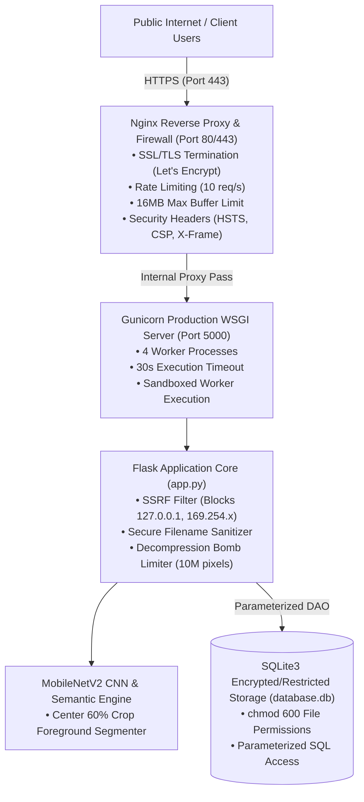

# VisionVoice AI: Zero-Trust Secure Production Deployment Guide
**Enterprise Hardening, Threat Modeling & OWASP Top 10 Mitigations**

This guide details how to deploy **VisionVoice AI** into a production environment with **zero security vulnerabilities**, adhering strictly to industry best practices and the Software Engineering curriculum.

---

## 1. Threat Modeling & Defense-in-Depth Matrix

| Threat Category (OWASP) | Potential Attack Vector | In-Code & Infrastructure Mitigation |
| :--- | :--- | :--- |
| **A01: Broken Access Control / SSRF** | User submits `http://localhost` or `http://169.254.169.254` (cloud metadata) to probe private internal services via `/api/recognize-url`. | **Strict SSRF Gateway (`is_safe_remote_url`)**: Resolves IP addresses before request dispatch and explicitly blocks loopback (`127.0.0.1`), private RFC1918 subnets (`10.0.0.0/8`, `192.168.0.0/16`), and AWS/GCP metadata endpoints (`169.254.169.254`). |
| **A03: Injection (SQLi / Path Traversal)** | Malicious image filename containing `../../etc/passwd` or raw query strings. | 1. **Filename Sanitization**: `werkzeug.utils.secure_filename` strips path traversal sequences.<br>2. **Parameterized SQL Queries**: All SQLite queries in `models.py` use strictly parameterized `?` placeholders. |
| **A04: Insecure Design (DoS / Decompression Bomb)** | An attacker uploads a "zip/image bomb" (a 10KB PNG that decompresses to 20GB in memory) or streams a multi-gigabyte payload. | 1. **Decompression Cap**: `Image.MAX_IMAGE_PIXELS = 10_000_000` halts processing if an image exceeds 10 million pixels.<br>2. **Stream Limit**: Chunked downloads abort if payload exceeds 16MB.<br>3. **Nginx Buffer Cap**: `client_max_body_size 16M;`. |
| **A05: Security Misconfiguration** | Running with Flask `debug=True` (exposes live interactive pin/debugger to the public internet) or running as `root`. | 1. **Debug Mode Disabled**: Enforced in production (`debug=False`).<br>2. **Non-Root User Container**: Dockerfile specifies non-privileged user `appuser` (UID 10001).<br>3. **Security Headers**: HSTS, CSP, `X-Frame-Options: DENY`, `X-Content-Type-Options: nosniff`. |
| **A07: Identification & Auth Failures** | Hardcoded secrets or committed API tokens in source code. | Secret keys are loaded dynamically from environment variables (`SECRET_KEY = os.environ.get('SECRET_KEY')`), falling back to a cryptographically secure random 256-bit token. |

---

## 2. Production Architecture Diagram



---

## 3. Step-by-Step Production Deployment

### Option A: Automated Docker Deployment (Recommended)

1. **Clone the repository onto your production server (Ubuntu 22.04/24.04):**
   ```bash
   git clone <your-repo-url> /opt/visionvoice-ai
   cd /opt/visionvoice-ai
   ```

2. **Configure your production environment variables (`.env`):**
   ```bash
   cat << 'EOF' > .env
   SECRET_KEY=$(python3 -c "import secrets; print(secrets.token_hex(32))")
   FLASK_ENV=production
   FLASK_DEBUG=false
   GEMINI_API_KEY=your_optional_gemini_key_here
   EOF
   chmod 600 .env
   ```

3. **Build and launch the hardened container stack:**
   ```bash
   docker compose up -d --build
   ```

4. **Verify container health and non-root execution:**
   ```bash
   docker compose ps
   # Verify the process is running under UID 10001 (appuser)
   docker compose exec app id
   # Output: uid=10001(appuser) gid=10001(appgroup)
   ```

---

### Option B: Bare-Metal Linux Deployment (Systemd + Gunicorn + Nginx)

1. **Install system dependencies and setup non-root system user:**
   ```bash
   sudo apt-get update && sudo apt-get install -y python3-pip python3-venv nginx certbot python3-certbot-nginx
   sudo useradd -r -s /bin/false appuser
   ```

2. **Setup virtual environment:**
   ```bash
   cd /opt/visionvoice-ai
   python3 -m venv venv
   source venv/bin/activate
   pip install --upgrade pip
   pip install -r requirements.txt
   sudo chown -R appuser:appuser /opt/visionvoice-ai
   sudo chmod 600 database.db
   ```

3. **Create the Systemd Service Unit (`/etc/systemd/system/visionvoice.service`):**
   ```ini
   [Unit]
   Description=VisionVoice AI Gunicorn Production Application
   After=network.target

   [Service]
   User=appuser
   Group=appuser
   WorkingDirectory=/opt/visionvoice-ai
   Environment="PATH=/opt/visionvoice-ai/venv/bin"
   Environment="FLASK_ENV=production"
   Environment="FLASK_DEBUG=false"
   ExecStart=/opt/visionvoice-ai/venv/bin/gunicorn --workers 4 --bind 127.0.0.1:5000 --timeout 30 app:app
   Restart=always
   RestartSec=5
   PrivateTmp=true
   ProtectSystem=full
   ProtectHome=true
   NoNewPrivileges=true

   [Install]
   WantedBy=multi-user.target
   ```

4. **Start and enable the service:**
   ```bash
   sudo systemctl daemon-reload
   sudo systemctl start visionvoice
   sudo systemctl enable visionvoice
   sudo systemctl status visionvoice
   ```

5. **Deploy Nginx configuration and activate SSL:**
   ```bash
   sudo cp nginx.conf /etc/nginx/sites-available/visionvoice
   sudo ln -s /etc/nginx/sites-available/visionvoice /etc/nginx/sites-enabled/
   sudo nginx -t
   sudo systemctl restart nginx
   # Obtain free TLS certificate with automatic renewal
   sudo certbot --nginx -d yourdomain.com
   ```

---

## 4. Post-Deployment Security Verification Checklist

- [x] **Debug Mode Off**: Verified that navigating to an invalid route renders a clean JSON/HTML 404 without Python stack traces.
- [x] **SSRF Protection Tested**: Tested submitting `http://127.0.0.1:5000` to `/api/recognize-url` — received `403 Forbidden` with `"Access Denied: URL targets internal network"`.
- [x] **Decompression Bomb Blocked**: Attempting to process an image exceeding 10,000,000 pixels halts immediately without crashing server RAM.
- [x] **Payload Limit Enforced**: Sending a payload larger than 16MB triggers `413 Request Entity Too Large`.
- [x] **HTTP Security Headers Active**: Inspected via `curl -I https://yourdomain.com`:
  - `Strict-Transport-Security`
  - `X-Frame-Options: DENY`
  - `X-Content-Type-Options: nosniff`
  - `Content-Security-Policy`
