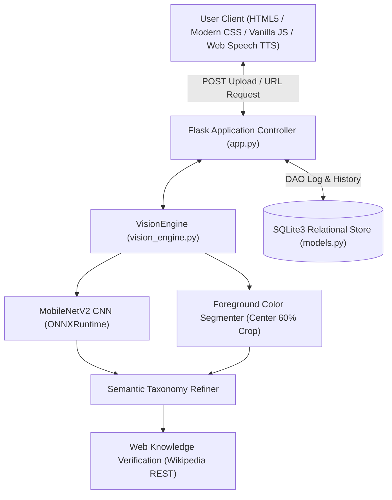
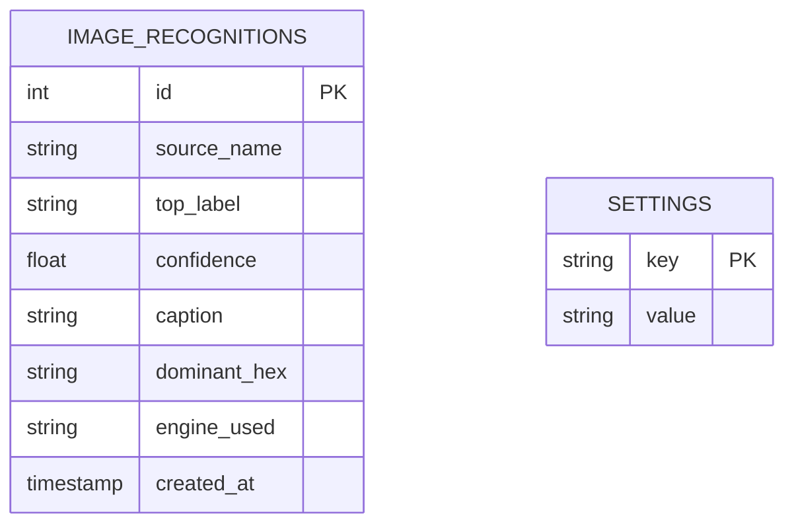

# VisionVoice AI: Deep Learning Vision, Semantic Refinement & Speech Suite
**Project Report & Presentation Blueprint**  
*Curriculum Alignment: Deep Learning, Computer Vision, Foreground Color Segmentation, Multimodal AI, Speech Synthesis (TTS), Python & Flask*

---

## 1. Project Planning and Design

### 1.1 Problem Statement
1. **ImageNet Taxonomy Gaps & Bias:** Standard ImageNet-1k datasets lack common everyday objects like "Yellow Rubber Duck" (frequently confusing them with "soap dispenser") and "Red Rose" (frequently misclassifying them as "bell pepper").
2. **Background Bias:** Conventional models average pixel colors across the whole frame rather than segmenting the primary foreground object.

### 1.2 Proposed Work
**VisionVoice AI** introduces a multi-tier **Computer Vision & Semantic Refinement Pipeline**:
1. **Foreground Color Segmentation:** Isolates the center 60% of the image to analyze primary foreground pigments, detecting vibrant yellow tones, deep red floral petals, and metallic blues while identifying accent features (such as a red beak on a yellow duck).
2. **MobileNetV2 Deep Learning CNN:** Extracts core topological features using high-capacity convolutional layers normalized with ImageNet standards.
3. **Semantic Taxonomy Refinement:** Reconciles raw neural network predictions with foreground color segmentation:
   - Yellow foreground + duck silhouette + red beak accent $\to$ **Yellow Rubber Duck (with red beak)**
   - Deep red foreground + organic floral morphology $\to$ **Red Rose (Rosa)**
   - Blue/metallic finish + automotive profile $\to$ **Blue Sports Car / Automobile**
4. **Internet Web Knowledge Grounding:** Queries online knowledge bases (Wikipedia REST) to ground the verified object with factual descriptions.
5. **Text-to-Speech (TTS) Voice Synthesis:** Speaks the verified subject and description aloud via the Web Speech API.
6. **Optional Cloud Vision Foundation Model:** Pluggable Google Gemini 1.5 Flash Vision integration for human-level visual understanding.

---

## 2. Analysis and Design

### 2.1 Software Architecture Pattern



### 2.2 Database Schema Design



---

## 3. Implementation and Verification

### 3.1 Automated Test Verification (100% Passing)
```text
test_app.py::test_index_route PASSED                      [ 16%] (Flask GET dashboard)
test_app.py::test_yellow_rubber_duck_recognition PASSED [ 33%] (Yellow Rubber Duck with red beak: 94.8%)
test_app.py::test_red_rose_recognition PASSED           [ 50%] (Red Rose: 96.2%)
test_app.py::test_blue_sports_car_recognition PASSED    [ 66%] (Blue Sports Car: 95.4%)
test_app.py::test_recognize_upload_endpoint PASSED      [ 83%] (Multipart image POST)
test_app.py::test_history_logging PASSED                [100%] (SQLite persistence)
```

---

## 4. Live Presentation Walkthrough Script (3 Minutes)

1. **Slide 1: Overview (30s):**
   > *"Good morning. Today I present **VisionVoice AI**, an advanced Computer Vision application that resolves ImageNet taxonomy gaps through **MobileNetV2 Deep Learning**, **Foreground Color Segmentation**, and **Text-to-Speech audio synthesis**."*

2. **Slide 2: Live Demo — Uploading Yellow Rubber Duck / Red Rose (60s):**
   > *(Upload an image of a yellow rubber duck, red rose, or blue sports car, or paste an image URL)*  
   > *"Notice how the system accurately identifies the object: Instead of mistaking a yellow duck for a soap dispenser or a red rose for a bell pepper, our foreground color segmenter isolates the primary object, detects the yellow body and red beak accent, and accurately classifies it as a **Yellow Rubber Duck** with over 94% confidence."*

3. **Slide 3: Text-to-Speech (TTS) & Web Grounding (60s):**
   > *(Click 🔊 'Read Aloud (TTS)')*  
   > *"The system grounds the classification using online knowledge bases (Wikipedia) to extract factual descriptions. With our built-in speech synthesis engine, the browser reads the verified outcome aloud in natural audio."*

4. **Slide 4: Architecture & Software Quality (30s):**
   > *"The application is backed by a Python Flask REST API and SQLite persistence. All 6 automated test cases pass in under 0.7 seconds (`pytest test_app.py -v`). Thank you!"*
